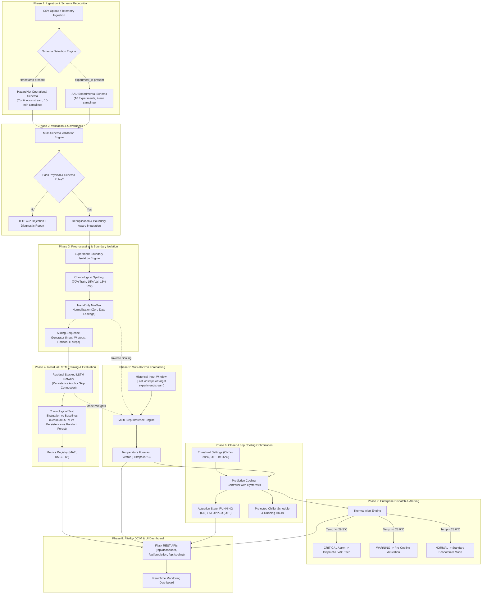
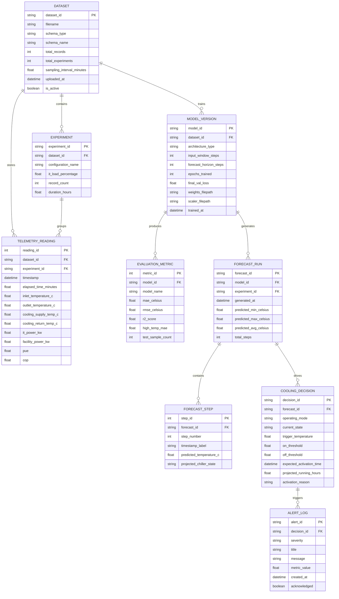
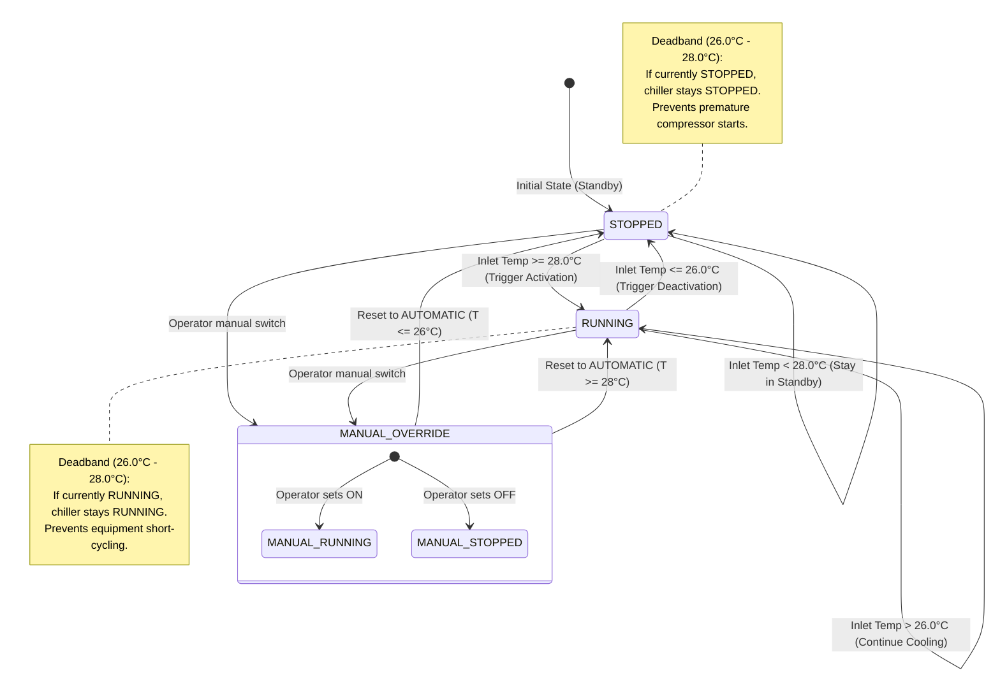
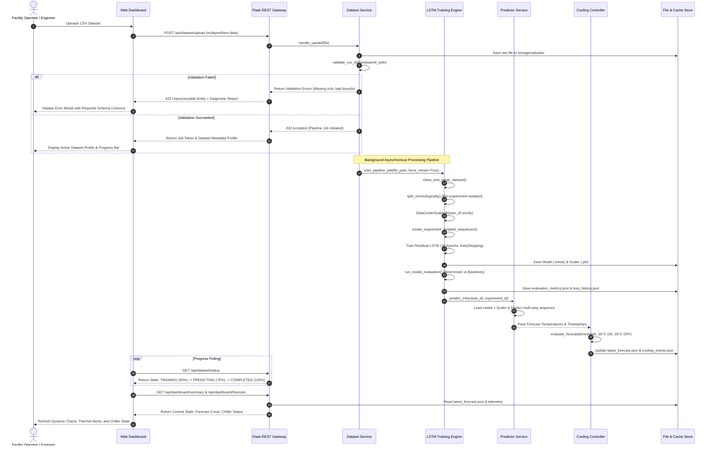

# End-to-End Enterprise Reference Process (ERP) & System Architecture Specification
## LSTM-Based Data Center Temperature Prediction & Predictive Cooling Optimization System

---

## Executive Overview

The **LSTM-Based Data Center Temperature Prediction and Predictive Cooling Optimization System** operates as an enterprise-grade cyber-physical platform that bridges multi-sensor telemetry ingestion, deep learning time-series forecasting, and automated cooling actuation. 

This document defines the complete **End-to-End Reference Process (ERP)**, outlining:
1. **The 8-Phase Core Operational Pipeline** (Ingestion $\rightarrow$ Validation $\rightarrow$ Isolated Preprocessing $\rightarrow$ Residual LSTM Training $\rightarrow$ Multi-Horizon Forecasting $\rightarrow$ Hysteresis Control $\rightarrow$ Alert Dispatch $\rightarrow$ Facility Visualization).
2. **The Enterprise Resource Planning & DCIM Integration Model** (Asset tracking, energy accounting, PUE/CoP calculation, and maintenance automation).
3. **The Entity-Relationship (ER) Data Model** (Entities, relationships, attributes, and foreign keys).
4. **Predictive Closed-Loop Hysteresis State Machine** (Anti-chatter chiller control logic).

---

## 1. End-to-End Process Flowchart



---

## 2. Functional Enterprise Modules (ERP Decomposition)

```
┌────────────────────────────────────────────────────────────────────────┐
│             DATA CENTER PREDICTIVE COOLING ERP PLATFORM                 │
├─────────────────┬─────────────────┬──────────────────┬─────────────────┤
│ 1. DATA         │ 2. MACHINE      │ 3. DECISION      │ 4. FACILITY     │
│ GOVERNANCE      │ LEARNING & AI   │ & HVAC CONTROL   │ & ENERGY ERP    │
├─────────────────┼─────────────────┼──────────────────┼─────────────────┤
│ • Multi-Schema  │ • Residual      │ • Dual-Threshold │ • PUE & CoP     │
│   Ingestion     │   Stacked LSTM  │   Hysteresis     │   Accounting    │
│ • Experiment    │ • Persistence   │ • Anti-Chatter   │ • Work Order    │
│   Isolation     │   Anchoring     │   Hold Logic     │   Generation    │
│ • Domain Bounds │ • Multi-Horizon │ • Manual/Auto    │ • Chiller Run-  │
│   Verification  │   Projection    │   Overrides      │   Time Tracking │
│ • Train-Only    │ • Baseline      │ • Thermal Alarm  │ • Historical    │
│   MinMax Scale  │   Benchmarking  │   Escalation     │   Auditing      │
└─────────────────┴─────────────────┴──────────────────┴─────────────────┘
```

---

## 3. Entity-Relationship (ER) Data Model



---

## 4. Closed-Loop Predictive Cooling State Machine



---

## 5. End-to-End Sequence Diagram



---

## 6. Enterprise Integration & Maintenance Roadmap

| Integration Layer | Protocol / Interface | Enterprise Function |
| :--- | :--- | :--- |
| **BMS / SCADA** | BACnet/IP, Modbus TCP | Dispatches physical start/stop commands to variable-speed chillers and chilled-water pumps. |
| **IT Telemetry** | Redfish API, IPMI, SNMPv3 | Ingests real-time server rack power consumption, inlet airflow, and internal compute load. |
| **Enterprise ERP** | REST API / Webhooks | Logs daily cooling energy consumption ($kWh$), calculates operational expenditures ($\$$), and tracks PUE trends. |
| **ITSM (ServiceNow)** | Incident Management API | Automatically triggers high-priority incident tickets when forecasted inlet temperatures exceed $29.5^\circ\text{C}$ for $> 30$ continuous minutes. |
| **Asset CMMS** | Maintenance Work Orders | Monitors compressor start/stop cycle frequency and flags maintenance intervals when runtime exceeds 2,500 hours. |
