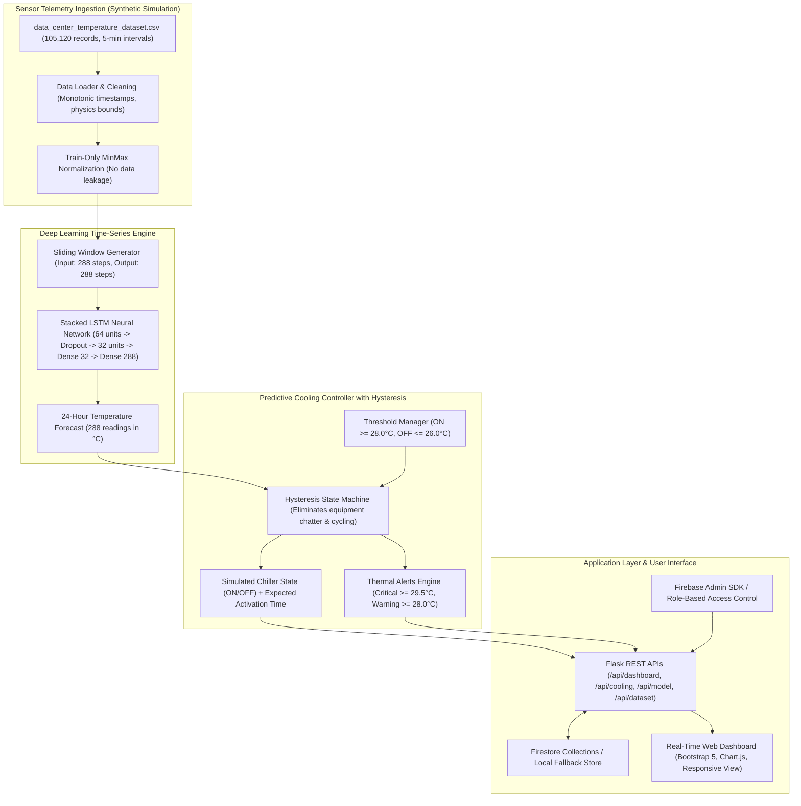

# System Architecture & Technical Specification

## 1. Architectural Overview

The **LSTM-Based Data Center Temperature Prediction and Predictive Cooling Optimization System** is engineered to bridge deep learning time-series forecasting with simulated data center thermal management.

---

## 2. Mathematical Formulation & Forecasting Horizon

Let the sequence of multivariate sensor readings up to current time $t$ be represented as:

$$\mathbf{X}_{t} = \left[ \mathbf{x}_{t - W + 1}, \mathbf{x}_{t - W + 2}, \dots, \mathbf{x}_{t} \right] \in \mathbb{R}^{W \times D}$$

Where:
- $W = 288$ time-steps (corresponding to 24 hours at 5-minute sampling intervals).
- $D = 9$ input features:
  1. `inlet_temperature`
  2. `outlet_temperature`
  3. `hot_aisle_temperature`
  4. `cold_aisle_temperature`
  5. `humidity`
  6. `cpu_usage`
  7. `it_power_consumption`
  8. `outdoor_temperature`
  9. `cooling_power_consumption`

The multi-step regression objective is to forecast future server inlet temperatures over the horizon $H = 288$ steps:

$$\hat{\mathbf{y}}_{t + 1 : t + H} = f_{\theta}(\mathbf{X}_{t}) = \left[ \hat{y}_{t+1}, \hat{y}_{t+2}, \dots, \hat{y}_{t+H} \right] \in \mathbb{R}^{H}$$

Where $f_{\theta}$ is the parameterized stacked LSTM neural network trained using Mean Squared Error (MSE) loss:

$$\mathcal{L}_{\text{MSE}}(\theta) = \frac{1}{H} \sum_{k=1}^{H} \left( y_{t+k} - \hat{y}_{t+k} \right)^2$$

---

## 3. Hysteresis Cooling Controller Formulation

To eliminate rapid actuator toggling (short-cycling) around temperature setpoints, the predictive controller incorporates a finite-state hysteresis band:

$$S_{t+k} = \begin{cases} 
\text{ON}, & \text{if } \hat{y}_{t+k} \ge T_{\text{ON}} \\
\text{OFF}, & \text{if } \hat{y}_{t+k} \le T_{\text{OFF}} \\
S_{t+k-1}, & \text{if } T_{\text{OFF}} < \hat{y}_{t+k} < T_{\text{ON}} 
\end{cases}$$

Default Configuration:
- $T_{\text{ON}} = 28.0^\circ\text{C}$
- $T_{\text{OFF}} = 26.0^\circ\text{C}$
- Hysteresis Deadband $\Delta T = 2.0^\circ\text{C}$

---

## 4. REST API Endpoint Specifications

| Method | Endpoint | Authorization | Description |
|---|---|---|---|
| `POST` | `/api/auth/login` | Public | Authenticates user and returns session/token |
| `POST` | `/api/auth/verify` | Bearer Token | Verifies Firebase ID Token |
| `GET` | `/api/auth/me` | Session/Bearer | Returns authenticated user profile and role |
| `GET` | `/api/dataset/info` | Public | Returns dataset record counts, intervals, and columns |
| `GET` | `/api/dataset/preview` | Public | Returns sample records from sensor dataset |
| `GET` | `/api/dataset/statistics` | Public | Returns mean, std, quantiles for all sensor columns |
| `POST` | `/api/dataset/upload` | Admin | Validates and uploads new CSV sensor dataset |
| `GET` | `/api/model/status` | Public | Queries model training status and progress |
| `GET` | `/api/model/metrics` | Public | Returns MAE, RMSE, R² scores and learning curves |
| `POST` | `/api/model/train` | Admin | Triggers asynchronous background model retraining |
| `POST` | `/api/model/predict` | Public | Executes live LSTM inference across latest 288 steps |
| `GET` | `/api/cooling/status` | Public | Returns current chiller state and power telemetry |
| `GET` | `/api/cooling/history` | Public | Returns chiller state transition log |
| `PUT` | `/api/cooling/thresholds` | Admin | Updates and validates $T_{\text{ON}}$ and $T_{\text{OFF}}$ |
| `GET` | `/api/dashboard/summary` | Public | Returns unified dashboard overview KPIs |
| `GET` | `/api/dashboard/temperature`| Public | Returns historical telemetry points for specified hours |
| `GET` | `/api/dashboard/forecast` | Public | Returns 288-step future forecast with thresholds |
| `GET` | `/api/dashboard/alerts` | Public | Returns active warning and critical thermal alerts |
| `GET` | `/health` | Public | System health check endpoint for Docker & Render |

---

## 5. Firestore Database Collections

1. **`users`**: User identities, roles (`admin`, `operator`), display names, and registration timestamps.
2. **`datasets`**: Dataset metadata, row counts, storage URLs (Cloudinary/local), and validation results.
3. **`model_training`**: Epoch history, training duration, best validation loss, and timestamp.
4. **`predictions`**: Generated forecast metadata, predicted peak temperature, and run timestamps.
5. **`cooling_events`**: State transitions (`OFF` $\to$ `ON`, `ON` $\to$ `OFF`), trigger temperatures, and thresholds.
6. **`alerts`**: Critical thermal alerts, impending activation warnings, and incident logs.
7. **`system_settings`**: Active administrative thresholds ($T_{\text{ON}}$, $T_{\text{OFF}}$) and safety constraints.
